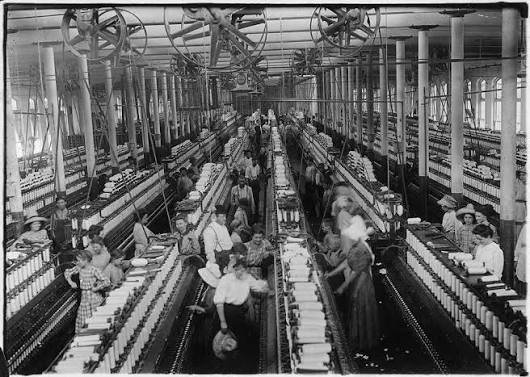
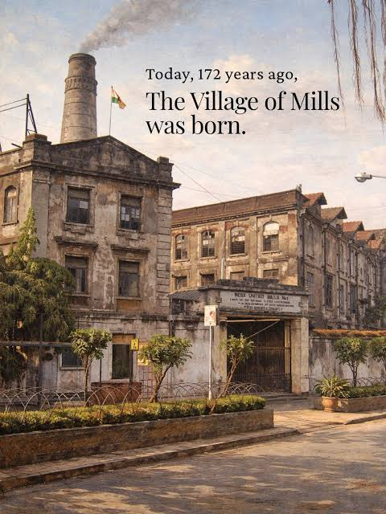
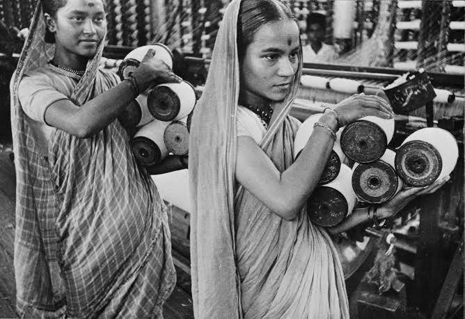

 

 
Paste your essay here, with a blank line between paragraphs.

 
## Data and credits
 
Where my map points came from, and how I collected them.
 
## What my map cannot show
 
One paragraph on what is missing.

The law restricted migration.[^1]
 
[^1]: Author, Title (Publisher, Year), page.
