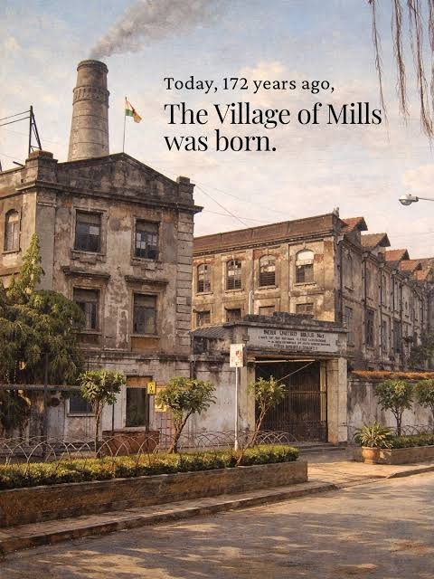
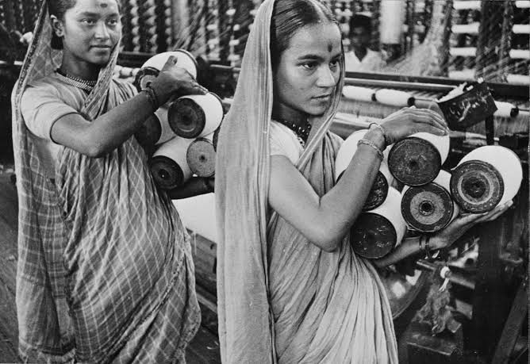

# Bombay textile Mills 1880-1990

A spatial history of how this place is connected to the larger world.

## Bombay and beyond- as an interconnected place

<iframe src="map/" width="100%" height="520"
  style="border:1px solid #ccc; border-radius:8px;"></iframe>

## Why Do I Care ?

Bombay is the Western region of Inida. It is a port city which was famous for its cotton manufacturing in the colonial times.

